# CataSync

**Schede prodotto per WooCommerce partendo dal codice a barre** — incolli EAN o codici
produttore, CataSync trova le pagine che pubblicano quei prodotti, controlla che riportino
davvero quel codice e prepara nome, marca, foto, descrizione e specifiche nella lingua del
negozio. Sul tuo server, multi-cliente, niente da installare sui siti.

🌐 Sito: [tastieredigitali.tech/casi-studio/td-sync-catalog](https://tastieredigitali.tech/casi-studio/td-sync-catalog/)

🇬🇧 [Read in English](README.md)

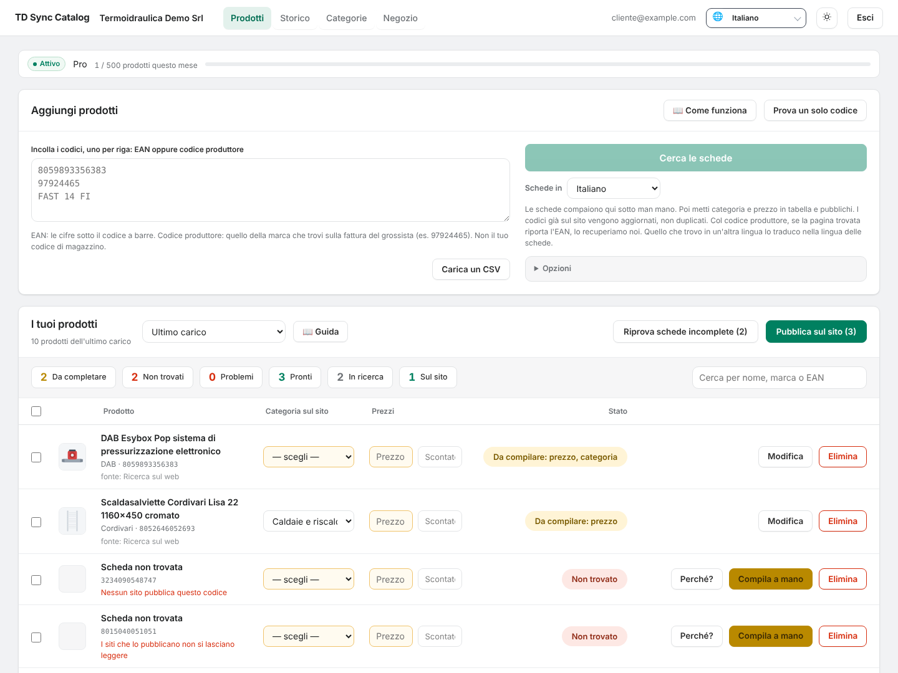

---

## Schermate

| | |
|---|---|
| **Perché?** — ogni mancato dice il motivo: le domande fatte, i motori che hanno risposto o bloccato, i siti aperti e cosa è successo su ciascuno.<br>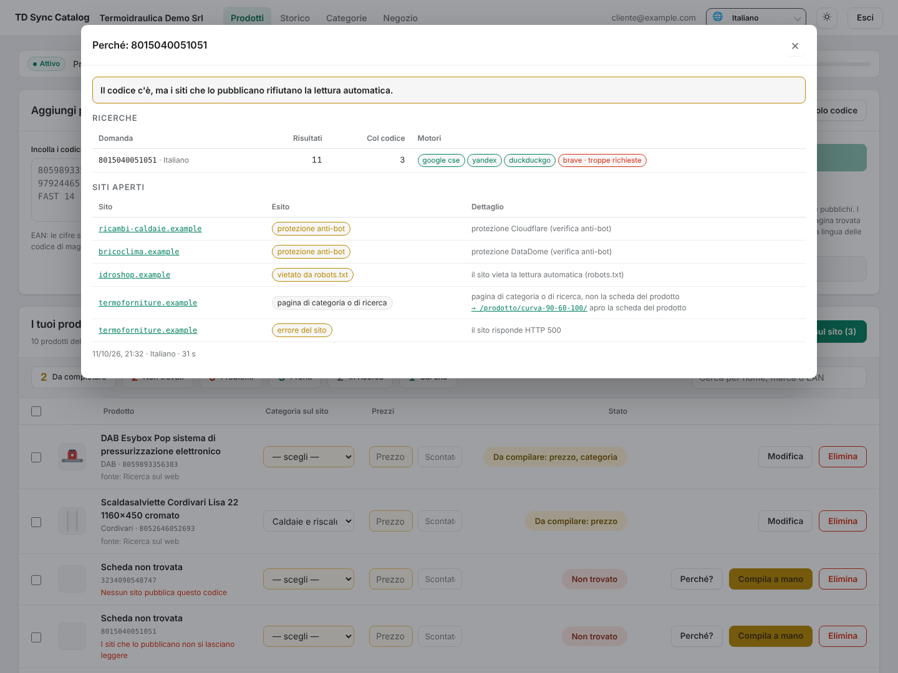 | **Niente online** — tre ricerche e nessuna pagina con quel codice: prova il codice produttore o compila la scheda a mano.<br>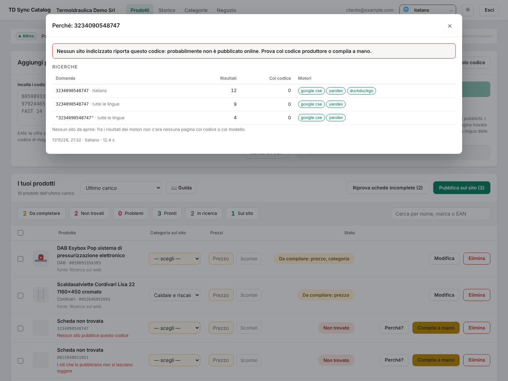 |
| **Correggi la scheda** — nome, marca, categoria, prezzi, descrizione, foto e specifiche prima di pubblicare.<br>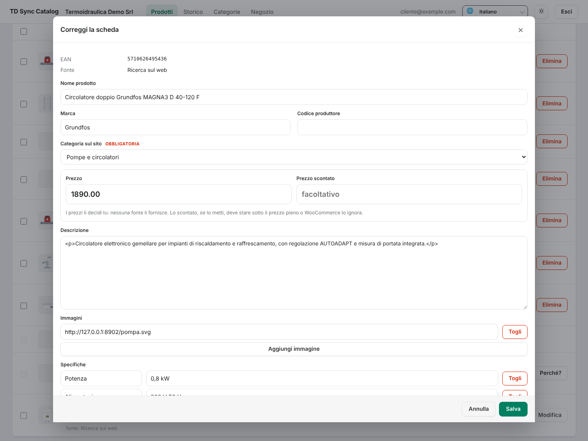 | **Tema scuro** — automatico, chiaro o scuro.<br>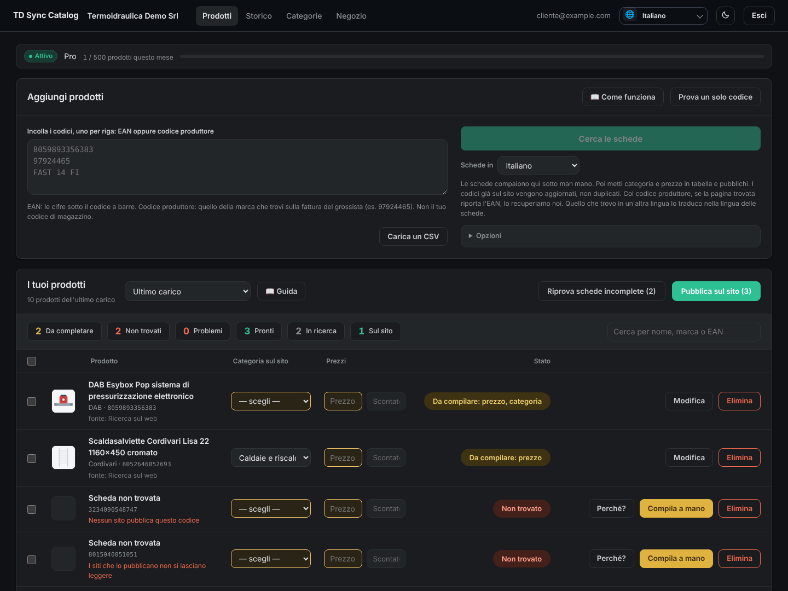 |
| **Impostazioni della ricerca** — motore, traduzione, browser, e com'è andata l'ultima settimana.<br>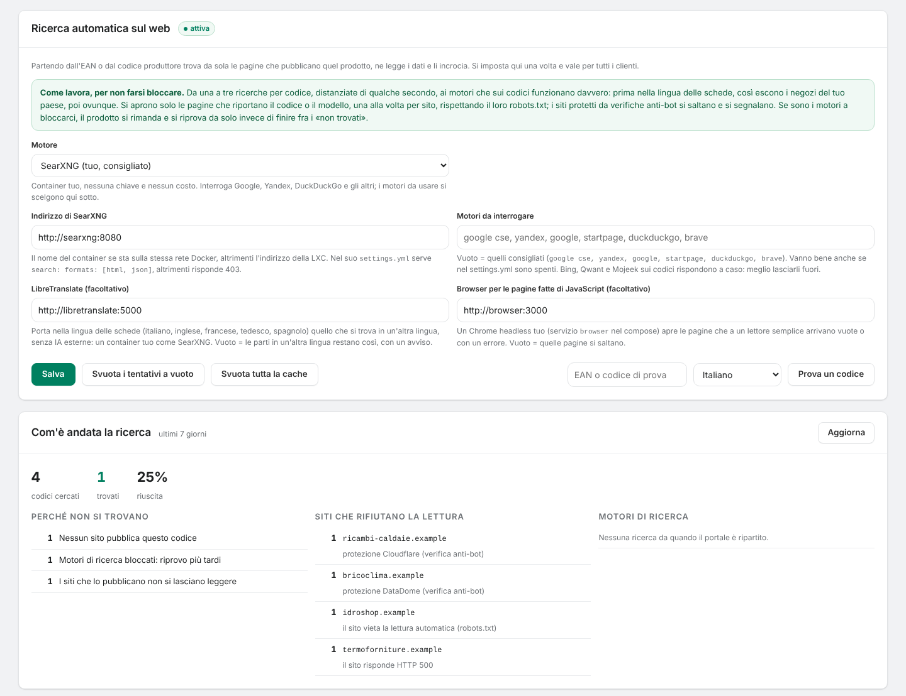 | **Aspetto del portale** — nome, logo e favicon del tuo portale.<br>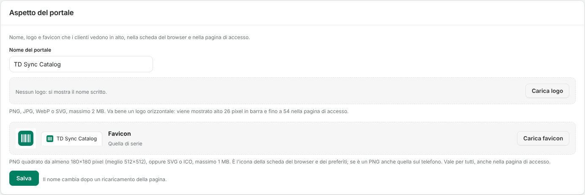 |
| **Categorie** — aggiungi (anche dentro un'altra), rinomini, elimini e metti in ordine le categorie del negozio, trascinandole o con le frecce.<br>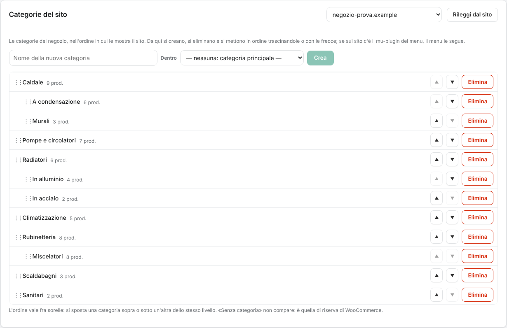 | **Elimina** — prima di eliminare una categoria mostra cosa c'è dentro e che fine fa.<br>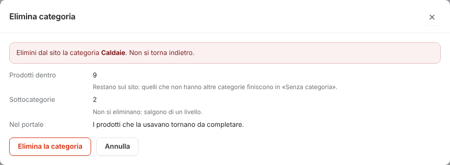 |
| **Guida** — tre guide (prodotti, magazzino, categorie) con le schermate, in una scheda a sé.<br>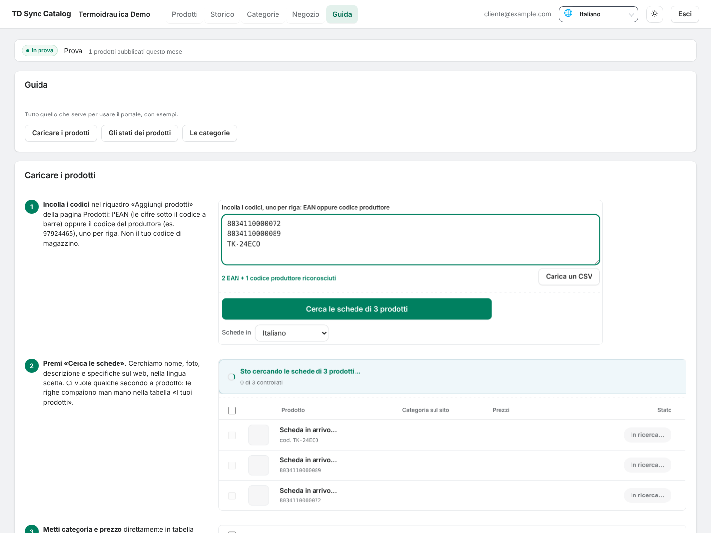 | **Magazzino** — i prodotti già sul sito per categoria, con ricerca, pagine, modifica e il cestino del sito.<br>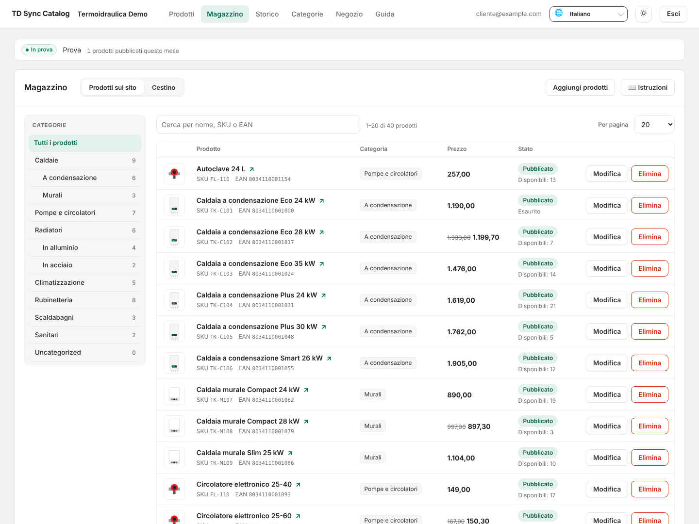 |
| **Scheda prodotto** — il prodotto intero com'è sul sito: nome, stato, prezzi, scorte, categorie, foto, descrizioni e specifiche.<br>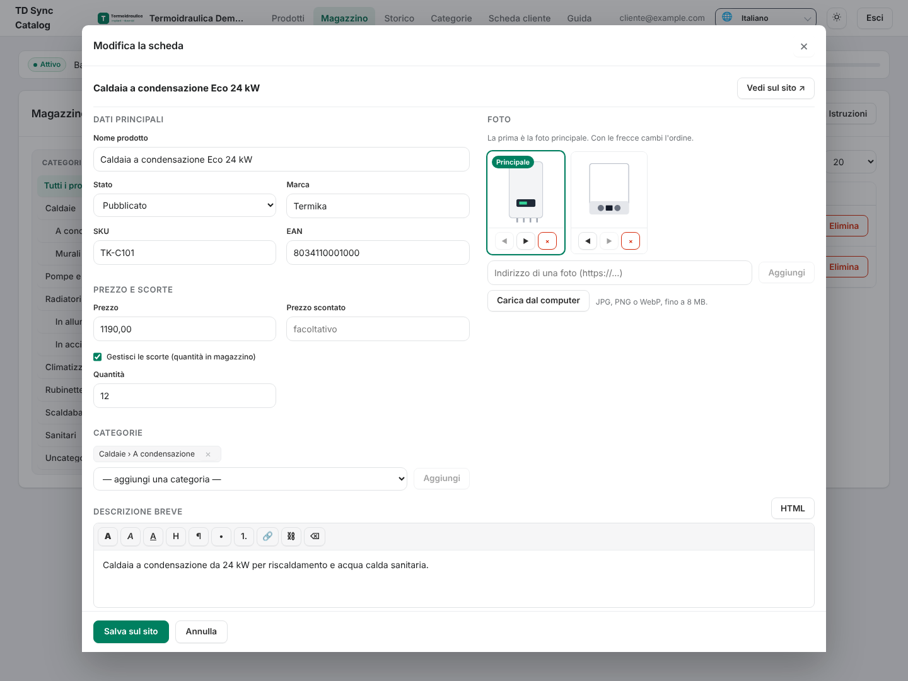 | **Scheda cliente** — anagrafica, logo e abbonamento come li imposta l'amministratore, in sola lettura per il cliente.<br>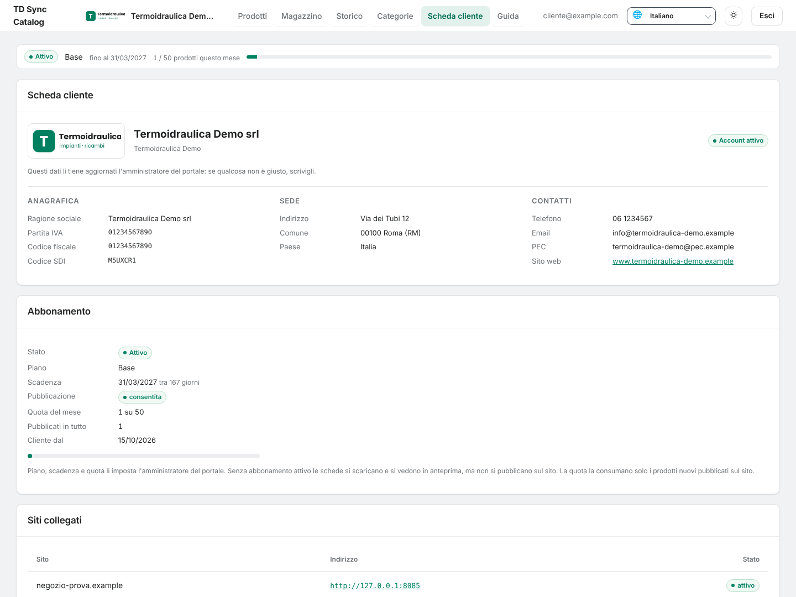 |

I dati mostrati sono una prova con nomi inventati e siti `.example`. L'interfaccia è in italiano,
inglese, francese e tedesco.

## Funzionalità

**Ricerca**
- Parte dall'**EAN** (le cifre sotto il codice a barre) o dal **codice produttore** che trovi
  sulla fattura del grossista; col codice produttore recupera anche l'EAN, se la pagina lo riporta.
- Passa dal **tuo SearXNG**: da una a tre domande per codice, distanziate di qualche secondo,
  solo ai motori che sui codici funzionano. Prima nella lingua e nel paese delle schede, poi
  ovunque, poi fra virgolette; si ferma appena due risultati riportano il codice.
- Se i motori bloccano (CAPTCHA, «troppe richieste») il codice **si rimanda e si riprova da
  solo** dopo 10, 30, 90 e 240 minuti, invece di finire fra i «non trovati» senza essere stato
  cercato.
- Legge i **dati strutturati** che i negozi pubblicano per i motori di ricerca (JSON-LD
  `schema.org/Product`, microdata, Open Graph), poi tabelle di specifiche e testo della pagina.
- Una pagina vale solo se **riporta quel codice** (dati strutturati, testo o indirizzo) o
  combacia col codice produttore; una pagina che dichiara un altro EAN si scarta. Pagine di
  categoria e ricerche interne si riconoscono e si segue il link del prodotto.
- Più siti che confermano si **incrociano e si fondono**: comanda la pagina più affidabile (EAN
  dichiarato, poi codice in pagina), le altre riempiono i buchi.
- Le foto si scaricano e si misurano: via segnaposto, loghi e immagini minuscole.
- Nessun testo scritto da un'intelligenza artificiale: solo quello che le pagine pubblicano. I
  prezzi non arrivano mai dalle pagine.

**Lettura amichevole**
- `robots.txt` rispettato (nome del programma `tdsynccatalog`, più le regole per `*`).
- Una richiesta ogni 1,5 secondi per sito, una pagina alla volta.
- Protezioni anti-bot (Cloudflare, Akamai, DataDome, Imperva, Sucuri, PerimeterX, CAPTCHA)
  riconosciute e **saltate, mai aggirate**, e segnalate nel diario della ricerca.
- Il browser senza finestra interviene solo per le pagine fatte col JavaScript e per i guasti
  del server.

**Perché non si trova**
- Un **diario della ricerca** per ogni codice e il pulsante **Perché?**: domande fatte, motori
  che hanno risposto o ci hanno bloccati (e perché), siti aperti, esito su ciascuno.
- Una causa chiara per ogni mancato: motori bloccati, motore irraggiungibile, nessun sito
  pubblica il codice, siti che rifiutano la lettura, nessuna pagina conferma, solo somiglianza
  del nome, codice interno del grossista.
- *Impostazioni → Com'è andata la ricerca*: stato dei motori, cause dei mancati, siti che
  rifiutano la lettura. *Prova a lotti*: un elenco di codici cercati uno per uno, con l'esito.

**Lingue**
- Schede in **italiano, inglese, francese, tedesco o spagnolo**: domande in quella lingua e in
  quel paese, pagine chieste in quella lingua, il resto tradotto dal **tuo LibreTranslate**. La
  cache è per codice e per lingua.
- Interfaccia in **italiano, inglese, francese e tedesco**: ognuno sceglie la sua.

**WooCommerce**
- Dialoga con le **REST API di WooCommerce** con una chiave in lettura/scrittura: niente da
  installare sui siti, funziona anche su quelli che non gestisci tu.
- Crea o aggiorna — mai duplica — per EAN (`global_unique_id`) o SKU: categorie, marche,
  attributi (quelli globali del sito quando il nome combacia), immagini.
- **Politiche di scrittura** per sito, campo per campo (mai / solo se vuoto / sempre), campi
  obbligatori e numero di specifiche.
- **Aggiornamento notturno** per sito, con politiche sue; le schede trovate da poco arrivano
  dalla cache.
- Eliminando un carico vedi prima cosa sparisce; con una password per applicazioni se ne vanno
  anche le immagini.

**Magazzino**
- I **prodotti già sul sito**, per categoria (clic su una categoria: i suoi prodotti e quelli
  delle sottocategorie), con la ricerca per nome, SKU o EAN e pagine da 15, 20, 30, 50 o 100.
- **Modifica** apre la **scheda intera** del prodotto com'è sul sito: nome, stato (pubblicato,
  bozza, in revisione, privato), marca, SKU ed EAN (controllato), prezzo, prezzo scontato, scorte,
  categorie, foto, descrizione breve, descrizione e specifiche. *Salva sul sito* la scrive subito.
- **Foto**: le riordini (la prima è la principale), le togli, le aggiungi con l'indirizzo o le
  **carichi dal computer** (JPG, PNG, WebP fino a 8 MB; serve `PUBLIC_URL`, perché il sito scarica
  il file dal portale).
- **Descrizioni** con un editor semplice (grassetto, corsivo, titoletti, elenchi, link) o
  direttamente in HTML; l'HTML viene ripulito prima di mandarlo. Le descrizioni con video, contenuti
  incorporati o moduli si lasciano a WordPress, così non si rompono; gli shortcode restano com'erano,
  come testo.
- **Specifiche**: quelle del prodotto si cambiano qui (più valori separati da `|`); gli attributi
  globali del sito e quelli usati per le varianti si vedono e restano come sono.
- **Categoria e prezzo** si cambiano anche con un clic direttamente nell'elenco; se il prodotto sta
  in più categorie cambia la prima. I prodotti con varianti tengono i prezzi sulle varianti.
- **Elimina** sposta il prodotto nel **cestino del sito**, quello di WooCommerce (*Prodotti →
  Cestino*): sparisce subito dal negozio. La vista **Cestino** mostra quello stesso cestino, anche
  i prodotti cestinati da WordPress, con **Ripristina** (stato e indirizzo di prima), **Elimina per
  sempre** e **Svuota il cestino**. WordPress lo svuota da solo dopo i giorni impostati sul sito
  (`EMPTY_TRASH_DAYS`, di serie 30; nel portale lo stesso numero si mette per negozio, per le
  date giuste). Le immagini restano nella libreria media.

**Categorie**
- Le **categorie del negozio si gestiscono dal portale**: le aggiungi (anche dentro un'altra), le
  rinomini, le elimini, le metti in ordine trascinandole o con le frecce. L'ordine è quello di
  WooCommerce (*Prodotti → Categorie*); una categoria nuova va in fondo al suo livello.
- Rinominando cambia il nome sul sito e nel portale; l'indirizzo della categoria (slug) resta
  quello, così i link non si rompono.
- Eliminando una categoria i prodotti restano sul sito (quelli senza altre categorie finiscono in
  «Senza categoria») e le sottocategorie salgono di un livello; nel portale i prodotti che la
  usavano tornano da completare.
- Il portale non tocca mai il menu del sito. Se le categorie le vuoi lì, il **mu-plugin**
  facoltativo (`wordpress/catasync-category-menu.php`) mette ogni categoria sotto la **voce di menu
  che scegli** sul sito, nello stesso ordine.

**Portale**
- Scheda **Guida** con tre guide — prodotti, magazzino, categorie — ognuna con le schermate di
  esempio nella lingua dell'interfaccia (italiano o inglese). Chi entra per la prima volta trova un invito alla Guida, che una volta chiuso resta
  chiuso su ogni dispositivo.
- Multi-cliente: clienti, negozi, utenti (amministratore, cliente), stato dell'abbonamento,
  piano e quota mensile.
- **Scheda cliente**: il cliente vede anagrafica, logo, abbonamento (stato, piano, scadenza, quota
  mensile, se può pubblicare), siti collegati e aggiornamento notturno. Li cambia solo
  l'amministratore, da *Clienti*.
- Categoria e prezzo li mette il cliente direttamente in tabella; una categoria si assegna a
  più righe insieme.
- Nome, logo e favicon del portale caricabili dal pannello; tema chiaro e scuro.
- **Verifica in due passaggi** per tutti, clienti e amministratori, dalla pagina *Account* (si
  apre con un clic sull'email in alto): **app di autenticazione** (codice QR), **codice via email**
  (col server SMTP del `.env`) o **passkey** (impronta, volto, PIN del dispositivo, chiave di
  sicurezza). Si possono attivare tutti e all'accesso si sceglie; con il primo arrivano dieci
  **codici di riserva**. Finché non è attiva, in cima al pannello una riga piccola lo ricorda.
  Attivarla, cambiarla o spegnerla chiede la password; da *Account* si cambia anche la password.
- **Avviso di manutenzione**: da *Impostazioni* si accende con giorno, ora d'inizio, ora di fine e
  una nota facoltativa. Compare nella pagina di accesso, sopra email e password, nella lingua di chi
  legge, e sparisce da solo a fine lavori.
- Chiavi REST cifrate a riposo, descrizioni ripulite prima di salvarle e pubblicarle, richieste
  solo verso indirizzi pubblici, SVG con contenuti attivi rifiutati.

## Requisiti

- Un server Linux con Docker e Docker Compose.
- Un reverse proxy con HTTPS davanti (NPMplus, Caddy, Traefik…).
- Accesso a internet in uscita: motori di ricerca, pagine dei prodotti, negozi WooCommerce.
- RAM: circa 1 GB per portale, database e SearXNG; LibreTranslate con cinque lingue e il
  browser ne vogliono circa 2 in più.

| Porta | Protocollo | Cosa |
|---|---|---|
| `HOST_PORT` (di serie 8811) | TCP | il portale, dietro il reverse proxy |

La porta ascolta su `BIND_ADDRESS` (di serie `127.0.0.1`). Database, SearXNG, LibreTranslate e
browser restano sulla rete interna di Docker.

## Installazione

```bash
git clone https://github.com/Giuseppe-sciarra/CataSync.git
cd CataSync

# 1. Configurazione
cp .env.example .env
nano .env        # almeno: SECRET_KEY, FERNET_KEY, POSTGRES_PASSWORD, SEARXNG_SECRET, ADMIN_EMAIL, ADMIN_PASSWORD

# 2. Cartella dei modelli di LibreTranslate (il container gira come utente 1032)
mkdir -p libretranslate && sudo chown -R 1032:1032 libretranslate

# 3. Avvio
docker compose up -d --build
docker compose logs -f hub

# 4. Aggiornamento automatico ogni notte (da root, vedi «Aggiornamenti»)
bash installa-aggiornamento.sh
```

I segreti:

```bash
openssl rand -hex 32                      # SECRET_KEY, e un'altra per SEARXNG_SECRET
openssl rand -base64 32 | tr '+/' '-_'    # FERNET_KEY
```

`POSTGRES_PASSWORD` solo lettere e numeri (finisce dentro un indirizzo). Tieni una copia di
`FERNET_KEY` fuori dal server: cifra le chiavi REST dei negozi e quelle dei motori di ricerca.

Poi apri il portale (`http://localhost:8811` per una prova in locale, con `COOKIE_SECURE=0`) ed
entra con `ADMIN_EMAIL` e `ADMIN_PASSWORD`. Dopo il primo accesso svuota `ADMIN_PASSWORD` nel
`.env` e rilancia `docker compose up -d`: l'utente ormai esiste e la password si cambia dal
pannello.

Al primo avvio LibreTranslate scarica i modelli delle lingue: la traduzione funziona qualche
minuto dopo.

Per il codice via email della verifica in due passaggi servono i dati del server di posta nel
`.env` (`SMTP_HOST`, `SMTP_PORT`, `SMTP_SECURITY`, `SMTP_USER`, `SMTP_PASSWORD`, `SMTP_FROM`):
senza, quel modo non si può attivare (l'app e le passkey funzionano comunque).

### Dietro un reverse proxy

```dotenv
PUBLIC_URL=https://catalogo.example.com
BIND_ADDRESS=127.0.0.1      # 0.0.0.0 se il proxy sta su un'altra macchina (es. NPMplus in un'altra LXC)
HOST_PORT=8811
COOKIE_SECURE=1
```

Nel proxy punta a `http://<server>:8811`. `PUBLIC_URL` deve essere l'indirizzo che si apre nel
browser: le richieste che scrivono vengono controllate su quello. Con `BIND_ADDRESS=0.0.0.0`
lascia passare la porta solo dall'indirizzo del proxy, col firewall.

### Con Portainer

- **Dal repository**: *Stacks → Add stack → Repository*, indirizzo di questo repository, compose
  path `docker-compose.portainer-git.yml`, e le variabili del `.env.example` in *Environment
  variables*. Portainer costruisce l'immagine sul nodo Docker. Questa variante alza solo il
  portale, con SQLite sul suo volume.
- **Immagine già pronta**: `docker-compose.portainer.yml` nel web editor, se pubblichi
  l'immagine su un registry (`HUB_IMAGE`).

Per avere insieme Postgres, SearXNG e LibreTranslate usa il `docker-compose.yml` completo.

## Collegare un negozio

1. **Clienti → Nuovo cliente**: nome e lingua delle schede.
2. **Siti → Nuovo sito**: cliente, nome, indirizzo e chiavi REST. Sul negozio: *WooCommerce →
   Impostazioni → Avanzate → API REST → Aggiungi chiave*, con permesso **Lettura/Scrittura**.
   Il consumer secret si vede una volta sola.
3. **Siti → Verifica**: risponde con le versioni di WordPress e WooCommerce, il numero di
   prodotti e se le Marche sono attive.
4. **Utenti → Nuovo utente**: email del cliente, ruolo Cliente, collegato al cliente. La
   password generata si vede una volta sola.

La ricerca sul web si imposta una volta sola in **Impostazioni** e vale per tutti i clienti.

## Categorie nel menu del sito (facoltativo)

Solo se vuoi le categorie nel menu del sito; senza il mu-plugin il menu non lo tocca nessuno.

1. Copia `wordpress/catasync-category-menu.php` da questo repository in `wp-content/mu-plugins/`
   del negozio. Parte da solo: non va attivato.
2. Sul sito apri *Aspetto → Menu categorie*, scegli in **Voce del menu** la voce sotto cui mettere
   le categorie (per esempio «Prodotti» nel menu principale), spunta **Attivo** e premi **Salva**.
3. Da lì in poi ogni categoria creata, eliminata, rinominata o spostata — dal portale o dal sito —
   si vede nel menu. **Allinea adesso** rimette in ordine la voce se ci hai messo le mani.

Il plugin lavora da solo sul sito: il portale non lo chiama, quindi alla chiave REST non servono
permessi in più.

## Specifiche e filtri (facoltativo)

Se il negozio mostra le specifiche col plugin **TD Product Specs** (meta `_td_product_specs`,
shortcode `[td_specifiche]` e campi YOOtheme), CataSync scrive anche lì
(*Siti → Modifica → Scrivi le specifiche anche per TD Product Specs*) e lavora insieme a quello che c'è sul sito:

- Quello che un prodotto ha già resta, comprese le righe scritte a mano. Con *Solo se vuoto* sulle
  specifiche CataSync aggiunge le voci che mancano; con *Sempre* aggiorna anche i valori delle stesse
  voci. Le voci che non conosce non si tolgono mai.
- Dalla versione 1.1 il plugin trasforma in filtri le etichette che scegli (*Prodotti → Filtri
  specifiche*), per i prodotti messi a mano come per quelli di CataSync. CataSync legge quali sono e
  quelle voci le scrive sempre, prima delle altre e oltre il numero di specifiche impostato per il
  sito: così i prodotti nuovi compaiono sotto i filtri.
- In *Magazzino → scheda prodotto* le specifiche di un prodotto che ha le righe del plugin sono
  quelle righe: le stesse che il negozio mostra e filtra. A un prodotto con le specifiche solo nel
  plugin non si creano attributi WooCommerce che non aveva.

Senza il plugin non cambia niente: il meta resta sul prodotto e non fa nulla.

## Perché un codice non si trova

Ogni ricerca si chiude con una causa, quella che il cliente vede in tabella e in **Perché?**:

| Causa | Cosa vuol dire | Cosa fare |
|---|---|---|
| Motori di ricerca bloccati | il codice non è stato cercato davvero | niente: si riprova da solo |
| Motore spento o irraggiungibile | SearXNG non risponde | controlla il container |
| Nessun sito pubblica questo codice | i motori rispondono, ma nessuna pagina riporta il codice | prova il codice produttore o compila a mano |
| I siti che lo pubblicano non si lasciano leggere | anti-bot, `robots.txt`, errori del sito | compila a mano, o chiedi al grossista un listino |
| Nessuna pagina conferma che sia lui | pagine simili, nessuna col codice giusto | controlla il codice |
| Trovato solo per somiglianza del nome | una sola pagina, senza il codice | compila a mano |
| Codice interno del grossista | prefisso 20–29 | usa l'EAN del produttore o il codice produttore |

## Lingue

La **lingua dell'interfaccia** la sceglie ognuno col selettore 🌐 (o segue il browser): cambia
solo i testi del portale.

La **lingua delle schede** è quella in cui nome, descrizione e specifiche arrivano su
WooCommerce. In ordine: quella fissata sul **sito** (*Siti → Modifica*), poi il selettore
**Schede in** sopra i codici (che parte dalla lingua dell'interfaccia), poi quella del
**cliente**. Quello che arriva in un'altra lingua lo traduce LibreTranslate e la scheda lo
segnala da rileggere; senza LibreTranslate la scheda resta nella lingua trovata, con un avviso.

## Dove si imposta cosa

| Cosa | Dove |
|---|---|
| Motore di ricerca, motori da interrogare, LibreTranslate, browser | *Impostazioni → Ricerca automatica sul web* |
| Stato dei motori, cause dei mancati, siti che rifiutano la lettura | *Impostazioni → Com'è andata la ricerca* |
| Un elenco di codici cercati uno per uno, con l'esito | *Impostazioni → Prova a lotti* |
| Nome, logo e favicon del portale | *Impostazioni → Aspetto del portale* |
| Avviso di manutenzione nella pagina di accesso | *Impostazioni → Avviso di manutenzione* |
| Verifica in due passaggi e password, per ogni utente | *Account* (l'email in alto a destra) |
| Togliere la verifica in due passaggi a chi ha perso telefono e codici | *Utenti → Togli 2FA* |
| Server di posta per il codice via email della verifica in due passaggi | `.env`: `SMTP_HOST`, `SMTP_PORT`, `SMTP_SECURITY`, `SMTP_USER`, `SMTP_PASSWORD`, `SMTP_FROM` |
| Prodotti già sul sito: ricerca, scheda completa, categoria, prezzo, cestino | *Magazzino* |
| Aggiungere, rinominare, eliminare e ordinare le categorie del negozio | *Categorie* |
| Voce di menu sotto cui vanno le categorie (mu-plugin facoltativo) | sul sito, *Aspetto → Menu categorie* |
| Clienti, piano, quota, fonti dati | *Clienti* |
| Chiavi REST, lingua del negozio, politiche di scrittura, campi obbligatori, aggiornamento notturno, giorni del cestino | *Siti → Modifica* |
| Utenti e ruoli | *Utenti* |
| Codici, categorie, prezzi, pubblicazione | *Prodotti* (area cliente) |
| Carichi, eliminazione di un carico | *Storico* |
| Categorie, attributi e marche del negozio | *Categorie* |
| Dati anagrafici e logo del cliente (lui li vede in *Scheda cliente*) | *Clienti → Modifica* |
| Pausa fra le ricerche, rinvii, cache | `.env`: `SEARCH_PAUSE`, `SEARCH_MAX_DEFERRALS`, `CACHE_DAYS` |
| Lingue caricate in LibreTranslate | `docker-compose.yml`: `LT_LOAD_ONLY` |
| Motori e sospensioni di SearXNG | `searxng/settings.yml` |

## Aggiornamenti

```bash
git pull --ff-only
docker compose pull searxng libretranslate browser
docker compose up -d --build
docker compose ps
```

Il database si aggiorna da solo all'avvio: niente migrazioni a mano. Tieni aggiornato SearXNG:
le versioni vecchie non hanno alcuni motori e al primo CAPTCHA sospendono un motore per un
giorno intero.

### Aggiornamento automatico ogni notte

`aggiorna-tutto.sh` aggiorna da solo, ogni notte, quello su cui gira CataSync:

- **il portale**: l'ultima versione di Python 3.12 con i pacchetti Debian della sua immagine e
  tutte le librerie di `requirements.txt` all'ultima versione;
- **PostgreSQL 17, SearXNG, LibreTranslate e browserless** (Chrome e Node): l'immagine nuova, se è
  uscita. PostgreSQL resta sulla 17.

Dopo ogni passo prova che tutto risponda: il portale su `/health`, SearXNG, LibreTranslate con
l'elenco delle lingue, browserless aprendo davvero una pagina. Se qualcosa non va torna da solo ai
file e alle immagini di prima. Alla fine manda un'email di riepilogo, solo se ha aggiornato
qualcosa o se qualcosa è andato storto. Il portale resta fermo 10-30 secondi, e solo quando c'è
qualcosa da aggiornare. Così SearXNG resta sempre aggiornato senza pensarci.

Il codice nuovo di CataSync non arriva da solo: per quello resta `git pull` (qui sopra).
Il passaggio a una versione maggiore di PostgreSQL non lo fa mai: si fa a mano, con backup e
ripristino.

Funziona con l'installazione fatta con `git clone` e `docker-compose.yml`. Con uno stack di
Portainer non va usato: lì gli aggiornamenti si fanno da Portainer.

Cosa serve: il server di posta nel `.env` (`SMTP_HOST` e gli altri `SMTP_*`), lo stesso della
verifica in due passaggi. Il riepilogo va a `ADMIN_EMAIL`; per mandarlo a un altro indirizzo metti
`AGG_MAIL_A=indirizzo` nel `.env`.

Su un'installazione nuova si attiva col passo 4 dell'installazione. Su un CataSync già installato,
dalla sua cartella e da root:

```bash
git pull --ff-only                  # porta i due script, se non ci sono ancora (dalla 2.10.1)
bash aggiorna-tutto.sh --dry-run    # prova a vuoto: dice cosa farebbe, non tocca niente
bash installa-aggiornamento.sh      # lo pianifica ogni notte
```

**Deve comparire**, alla fine della prova a vuoto, `── fine ──`, e dopo l'ultimo comando
`✅ Timer systemd installato: ogni notte alle 02:00` (senza systemd usa cron: `✅ Cron installato`). Le 02:00 vengono prima della ri-sincronizzazione notturna dei negozi (di
serie alle 03:00). Con un numero cambia l'ora: `bash installa-aggiornamento.sh 3` per le 03:00,
`bash installa-aggiornamento.sh 1:30` per l'01:30. Il timer è *Persistent*: se all'ora stabilita il
server era spento, l'aggiornamento parte appena si riaccende. Poi:

| Per | Comando |
|---|---|
| vedere se è attivo e com'è andata l'ultima volta | `bash installa-aggiornamento.sh --status` |
| leggere il log | `tail -f logs/aggiorna-tutto.log` |
| aggiornare subito | `bash aggiorna-tutto.sh` |
| togliere la pianificazione | `bash installa-aggiornamento.sh --remove` |

Il log non supera 1 MB: quando ci arriva restano le righe più recenti.

Valori facoltativi nel `.env`: `AGG_MAIL_SEMPRE=1` (email anche quando era già tutto aggiornato) e
`AGG_TIENI_ROLLBACK=3` (quante immagini di prima del portale tenere per tornare indietro, circa
0,5 GB l'una).

Per tenere ferma una libreria scrivi un limite nella sua riga di `requirements.txt`, con il motivo,
per esempio `httpx<1  # motivo`: le righe con un limite restano come sono.

Lo script riscrive `requirements.txt`, con una copia di riserva in `backups/`. Se `git pull` si
ferma perché il file è cambiato sul server, rimettilo come su GitHub, aggiorna e lascia che lo
script riporti tutto all'ultima versione:

```bash
git checkout -- requirements.txt
git pull --ff-only
bash aggiorna-tutto.sh
```

Ogni modifica di `main` che passa i controlli esce come
[release](https://github.com/Giuseppe-sciarra/CataSync/releases). La versione sta in
`VERSION.txt` e in fondo a ogni pagina: un numero nuovo in `VERSION.txt` si usa così com'è,
altrimenti sale di uno l'ultima cifra; `[minor]` o `[major]` nel titolo del commit fanno
salire la cifra di mezzo o la prima.

## Backup

```bash
docker compose exec -T db pg_dump -U hub hub > catasync-$(date +%F).sql
```

Conserva anche il volume `hub_data` (loghi, favicon, immagini delle categorie, cache delle
immagini) e il file `.env`: senza `FERNET_KEY` le chiavi REST salvate non si decifrano più.
`docker compose down` tiene i volumi; `docker compose down -v` li cancella.

## Se qualcosa non va

- **Tutti i codici «non trovati» o rimandati** — apri *Impostazioni → Com'è andata la
  ricerca*. Se i motori bloccano, i codici si riprovano da soli e i motori che bloccano restano
  in pausa (15 minuti, poi sempre di più) mentre lavorano gli altri; alza `SEARCH_PAUSE` e
  aggiorna SearXNG (`docker compose pull searxng`). Se a rispondere non resta nessuno per ore,
  l'unica via stabile è un'API ufficiale (Brave o Google) in *Ricerca automatica sul web*.
- **«SearXNG: uscita JSON non abilitata»** — il `settings.yml` in uso non ha
  `search: formats: [html, json]`: usa quello in `searxng/`.
- **Il container `searxng` non parte** — manca `SEARXNG_SECRET` nel `.env`.
- **Le schede restano in un'altra lingua** — LibreTranslate non è impostato in *Impostazioni* o
  sta ancora scaricando i modelli (`docker compose logs libretranslate`). Errori di permessi nel
  suo log: `sudo chown -R 1032:1032 libretranslate`.
- **Salvando esce «Richiesta con provenienza non valida.»** — `PUBLIC_URL` non è l'indirizzo
  aperto nel browser: correggilo o lascialo vuoto.
- **In HTTP semplice l'accesso non resta** — `COOKIE_SECURE=1` vuole HTTPS; `COOKIE_SECURE=0`
  solo per le prove in locale.
- **La verifica del negozio non passa** — la chiave REST deve avere il permesso
  Lettura/Scrittura e l'indirizzo dev'essere quello pubblico del negozio. Se il server butta via
  l'intestazione `Authorization` (certe configurazioni Apache), CataSync riprova da solo con le
  chiavi nell'indirizzo.
- **`FERNET_KEY` persa** — le chiavi REST dei negozi e quelle dei motori vanno reinserite.
- **Il codice dell'app di autenticazione non passa** — l'ora del telefono è sbagliata: mettila
  automatica. Ogni codice vale 30 secondi (più quello prima e quello dopo) e una volta sola.
- **La passkey non si aggiunge o non funziona più** — le passkey vogliono HTTPS (oppure
  `localhost`) e sono legate al dominio di `PUBLIC_URL`, o a quello aperto nel browser se è vuoto:
  cambiando dominio vanno registrate di nuovo.
- **Dopo aver cambiato `SECRET_KEY` o `FERNET_KEY` i codici non passano** — i codici di riserva
  dipendono da `SECRET_KEY`, i segreti delle app da `FERNET_KEY`: togli la verifica agli utenti
  (*Utenti → Togli 2FA*) e falla riattivare.
- **Amministratore chiuso fuori dalla verifica in due passaggi** (telefono e codici di riserva
  persi) — `docker exec -it catasync-hub python -m app.due_fattori togli admin@example.com`, poi
  rientra con la sola password e riattivala da *Account*. Per i clienti basta *Utenti → Togli 2FA*.
- **Categorie: «HTTP 403 dal sito»** quando aggiungi, rinomini o elimini — l'utente della chiave REST del
  negozio non può gestire le categorie dei prodotti: genera la chiave con un utente amministratore
  o gestore del negozio.
- **Le categorie non compaiono nel menu** — il mu-plugin va direttamente in
  `wp-content/mu-plugins/` (non in una sottocartella) e va acceso in *Aspetto → Menu categorie*.

## Documentazione

- `CHANGELOG.md` — cosa cambia in ogni versione.
- `SECURITY.md` — come segnalare una vulnerabilità.
- `THIRD-PARTY.md` — componenti di terze parti e loro licenze.
- `docs/GUIDA.md` — la guida completa: ricerca, prezzi, aggiornamento notturno, eliminazione dei
  carichi, abbonamenti, chiamate a WooCommerce.
- `docs/SICUREZZA.md` — note di sicurezza.
- `wordpress/catasync-category-menu.php` — il mu-plugin di WordPress, facoltativo, che mette le
  categorie nel menu del sito.

## Licenza

CataSync è software libero rilasciato sotto la [GNU Affero General Public License v3.0 o
successiva](LICENSE). Se fai girare una versione modificata per altre persone attraverso la rete,
devi offrire loro il suo codice sorgente: il link *Codice sorgente* in fondo a ogni pagina
(`SOURCE_URL`) serve a questo. I componenti di terze parti mantengono le loro licenze
(`THIRD-PARTY.md`).

Copyright © Giuseppe Sciarra — [Tastiere Digitali](https://tastieredigitali.it)

---

## Sostieni il progetto

Se CataSync ti è utile, puoi sostenerne lo sviluppo con una donazione:

**[paypal.me/raxiel87](https://paypal.me/raxiel87)**

Segnalazioni di bug e pull request sono benvenute.
