# CataSync

**WooCommerce product sheets from a barcode** — paste EANs or manufacturer codes, and CataSync
finds the pages that publish those products, checks that they really show that code and prepares
name, brand, photos, description and specifications in your shop's language. Self-hosted,
multi-client, nothing to install on the shops.

🌐 Website (in Italian): [tastieredigitali.tech/casi-studio/td-sync-catalog](https://tastieredigitali.tech/casi-studio/td-sync-catalog/)

🇮🇹 [Leggi in italiano](README.it.md)

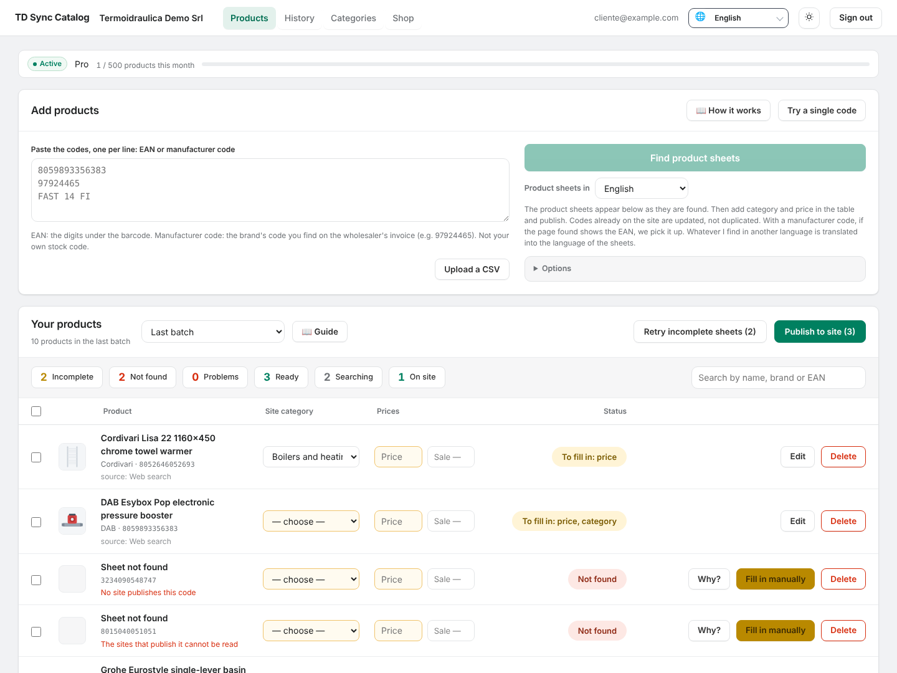

---

## Screenshots

| | |
|---|---|
| **Why?** — every miss says why: the queries, the engines that answered or blocked, the sites opened and what happened on each.<br>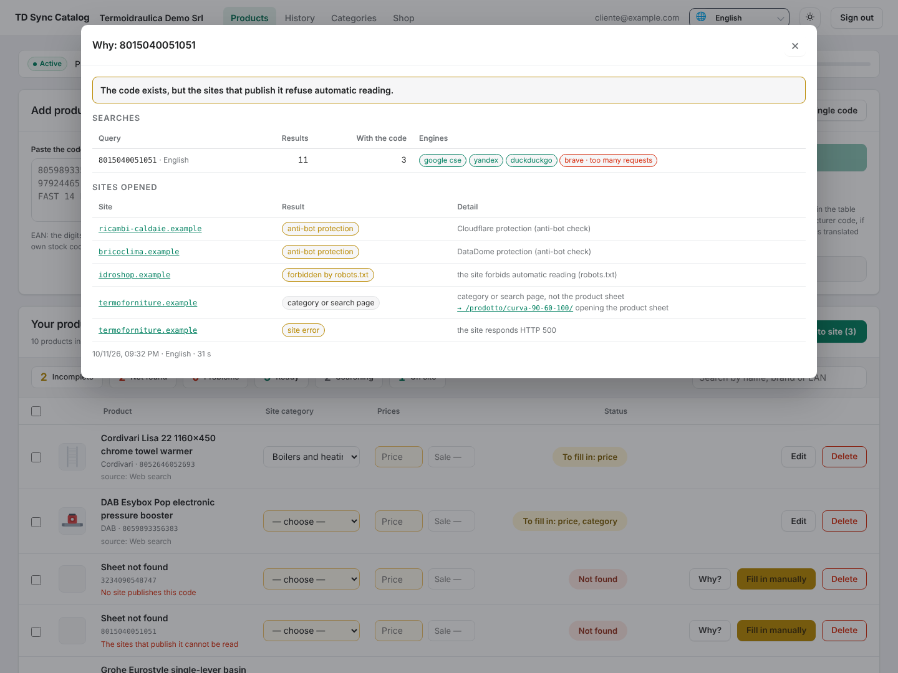 | **Nothing online** — three searches and no page with that code: try the manufacturer code or fill the sheet in by hand.<br>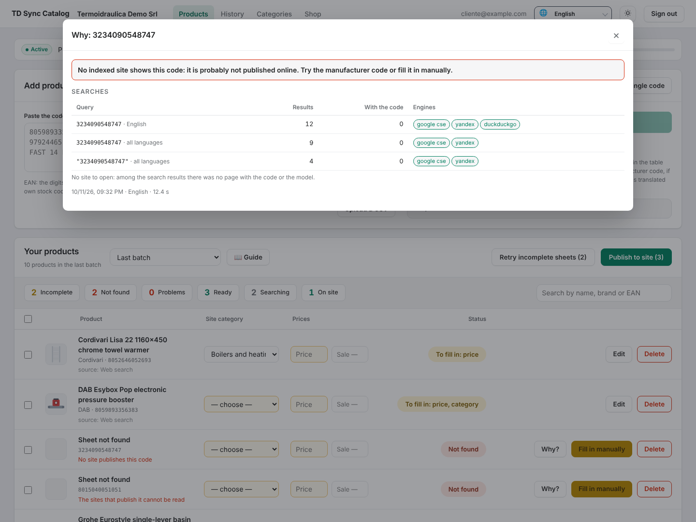 |
| **Edit** — name, brand, category, prices, description, photos and specifications before publishing.<br>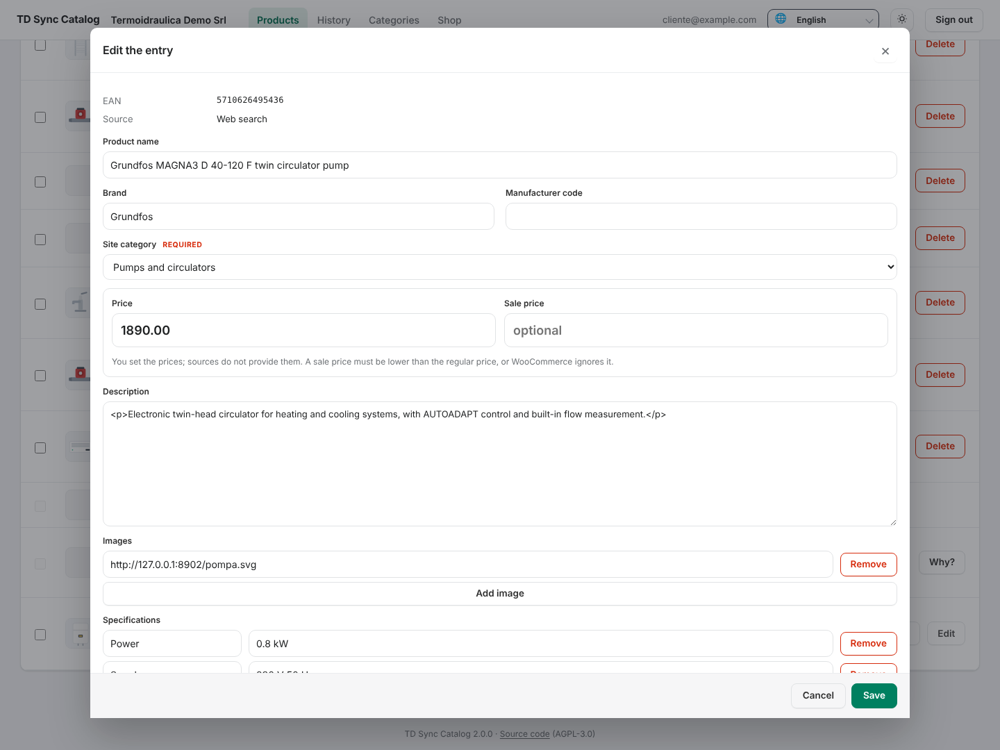 | **Dark theme** — automatic, light or dark.<br>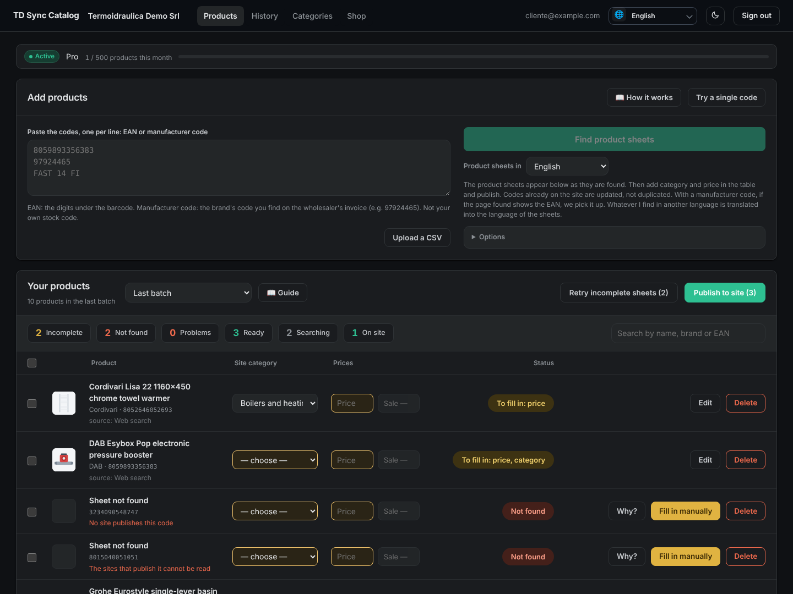 |
| **Search settings** — engine, translation, headless browser, and how the last searches went.<br>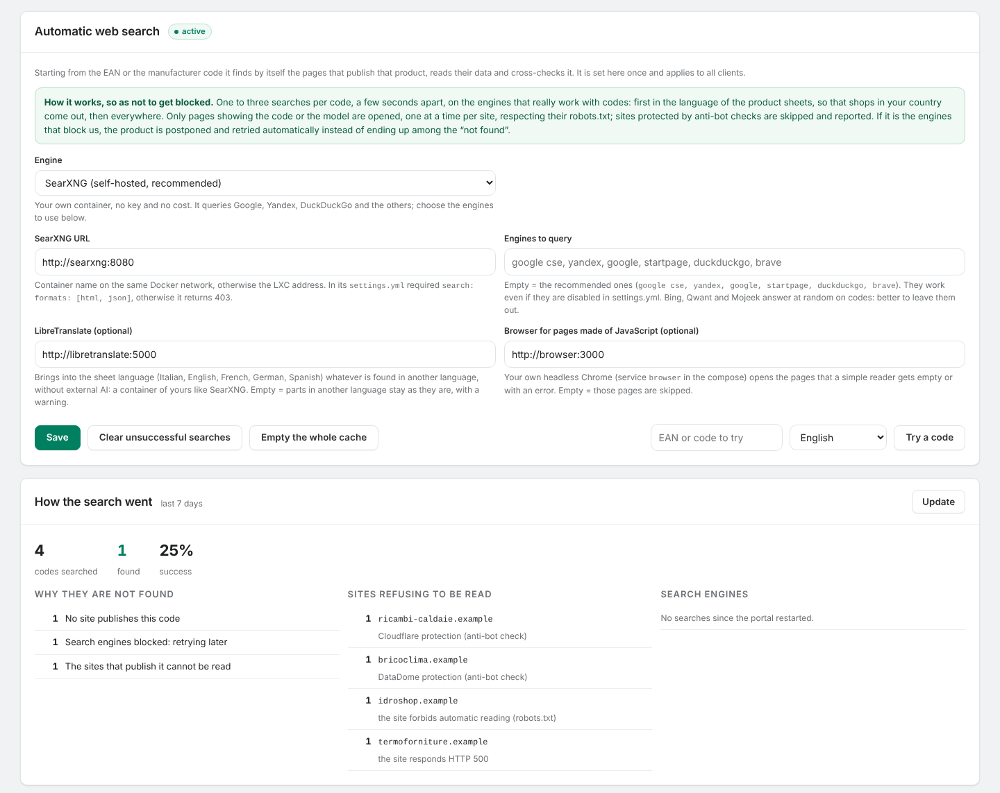 | **Portal appearance** — name, logo and favicon of your portal.<br>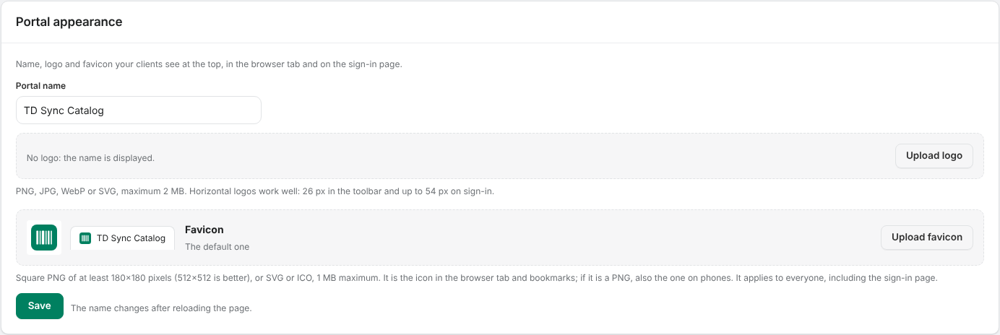 |
| **Categories** — add (also inside another one), rename, delete and reorder the shop's categories, by dragging them or with the arrows.<br>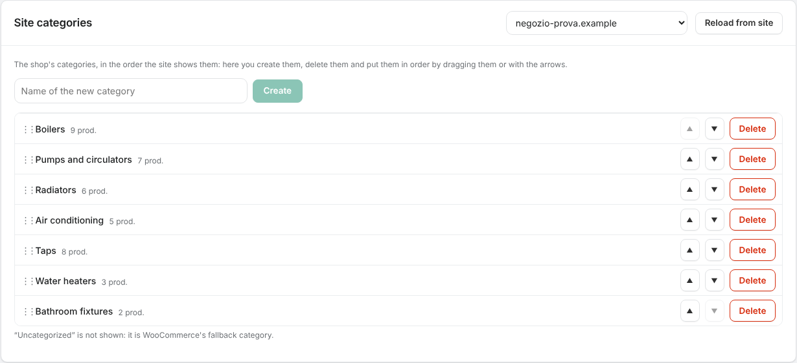 | **Delete** — before deleting a category it shows what is inside and what happens to it.<br>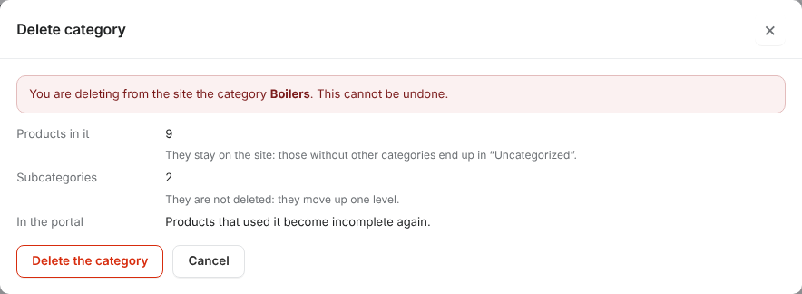 |
| **Guide** — three guides (products, warehouse, categories) with screenshots, in a tab of their own.<br>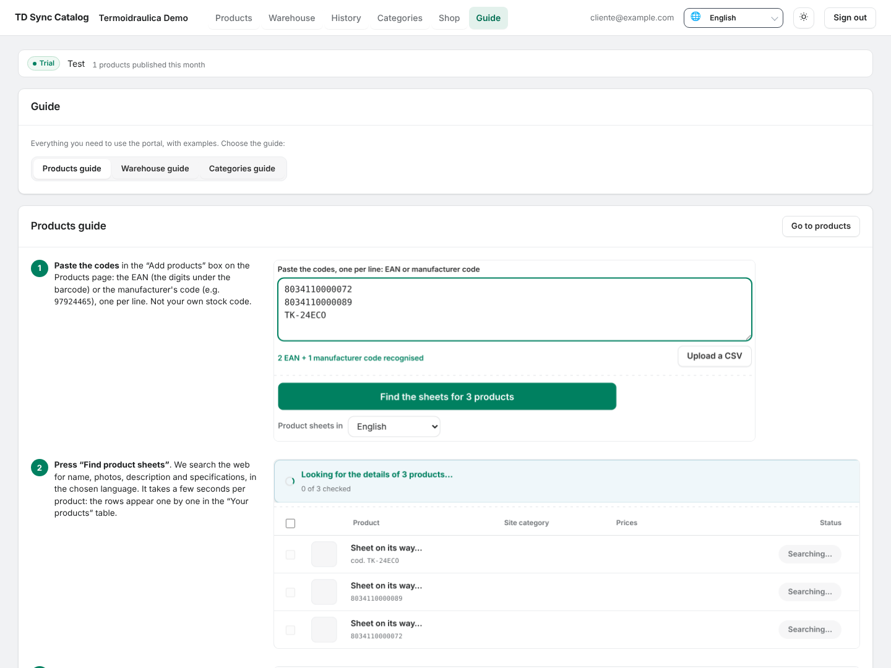 | **Warehouse** — the products already on the site by category, with search, pages, edit and the site's trash.<br>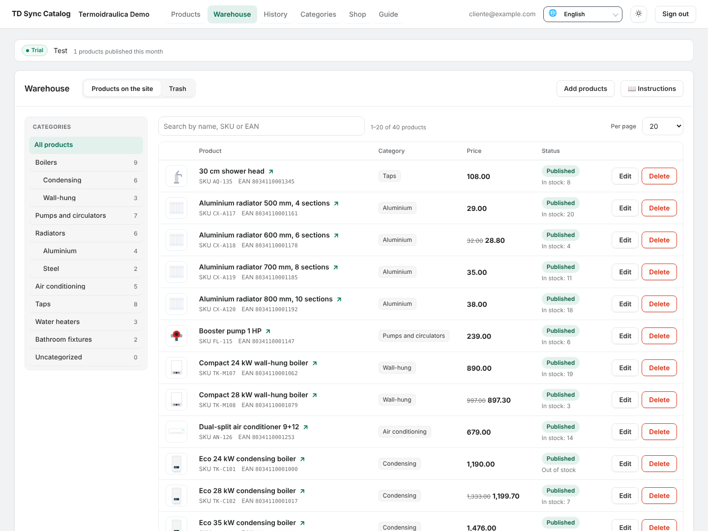 |
| **Product sheet** — the whole product as it is on the site: name, status, prices, stock, categories, photos, descriptions and specifications.<br>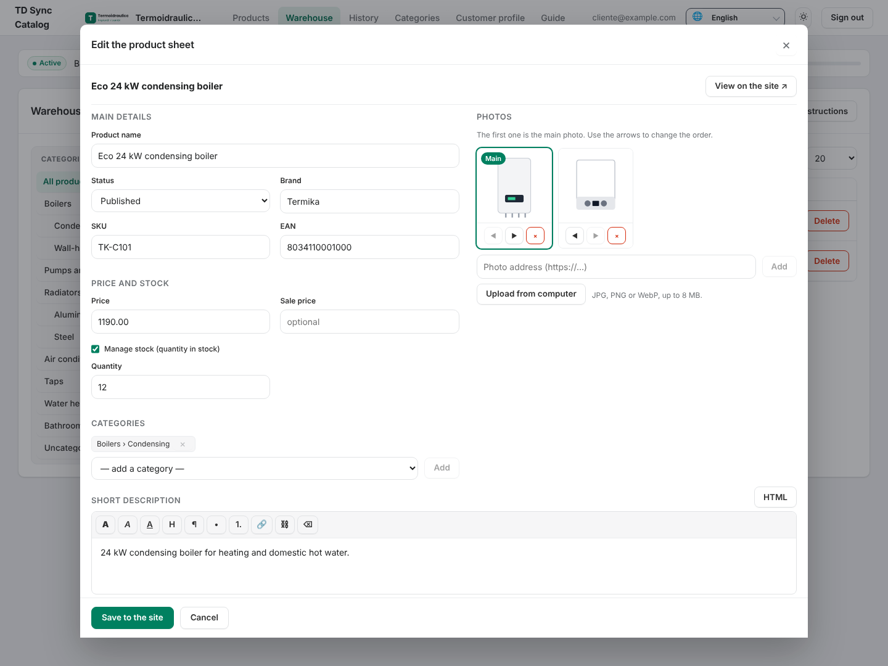 | **Customer profile** — company details, logo and subscription as set by the administrator, read-only for the client.<br>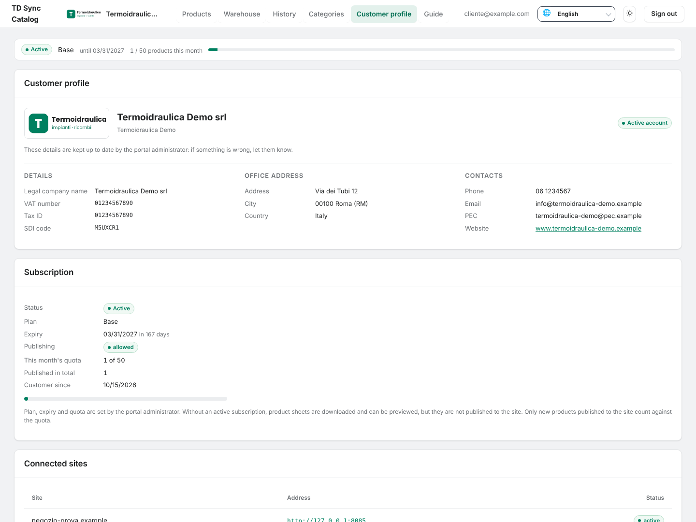 |

The data shown is a demo with made-up names and `.example` sites. The interface is available
in English, Italian, French and German.

## Features

**Search**
- Starts from the **EAN** (the digits under the barcode) or the **manufacturer code** found
  on the wholesaler's invoice; a manufacturer code also recovers the EAN when the page shows it.
- Runs through your own **SearXNG**: one to three queries per code, a few seconds apart, only
  to the engines that work on codes. First in the language and country of the sheets, then
  everywhere, then in quotes; it stops as soon as two results show the code.
- When the engines block (CAPTCHA, "too many requests") the code is **postponed and retried by
  itself** after 10, 30, 90 and 240 minutes, instead of ending up "not found" without having
  been searched.
- Reads the **structured data** that shops publish for search engines (JSON-LD
  `schema.org/Product`, microdata, Open Graph), then specification tables and page text.
- A page is trusted only if it **states that code** (structured data, text or address) or
  matches the manufacturer code; a page declaring a different EAN is discarded. Category and
  search pages are recognised and the link to the product is followed.
- Several confirming sites are **cross-checked and merged**: the most reliable page leads
  (declared EAN, then code on the page), the others fill the gaps.
- Photos are downloaded and measured: placeholders, logos and tiny images are dropped.
- No AI-written text: only what the pages publish. Prices never come from the pages.

**Friendly reading**
- `robots.txt` respected (user agent token `tdsynccatalog`, plus the rules for `*`).
- One request every 1.5 seconds per site, one page at a time.
- Anti-bot protections (Cloudflare, Akamai, DataDome, Imperva, Sucuri, PerimeterX, CAPTCHA)
  are recognised and **skipped, never bypassed**, and reported in the search diary.
- A headless browser steps in only for pages built with JavaScript and for server errors.

**Why not found**
- A **search diary** for every code and a **Why?** button: queries, engines that answered or
  blocked (and why), sites opened, result on each.
- A clear cause for each miss: engines blocked, engine unreachable, no site publishes the code,
  sites refusing automatic reading, no page confirms it, name similarity only, wholesaler's
  internal code.
- *Settings → How the search went*: engine status, causes of the latest misses, sites refusing
  to be read. *Batch test*: a list of codes searched one by one, with the outcome.

**Languages**
- Sheets in **Italian, English, French, German or Spanish**: queries in that language and
  country, pages requested in that language, the rest translated by your own
  **LibreTranslate**. The cache is kept per code and per language.
- Interface in **Italian, English, French and German**: each user picks theirs.

**WooCommerce**
- Talks to the **WooCommerce REST API** with a read/write key: nothing to install on the shops,
  it also works on sites you do not manage.
- Creates or updates — never duplicates — by EAN (`global_unique_id`) or SKU: categories, brands,
  attributes (the shop's global ones when the name matches), images.
- Per-site **write policies**, field by field (never / only if empty / always), required fields
  and number of specifications.
- **Nightly update** per site, with its own policies; sheets found recently come from the cache.
- Deleting a batch shows first what will be removed; with an application password the images go
  too.

**Warehouse**
- The **products already on the site**, by category (click a category, see its products and those
  of its subcategories), with a search by name, SKU or EAN and pages of 15, 20, 30, 50 or 100.
- **Edit** opens the **whole product sheet** as it is on the site: name, status (published, draft,
  pending, private), brand, SKU and EAN (checked), price, sale price, stock, categories, photos,
  short description, description and specifications. *Save to the site* writes it at once.
- **Photos**: reorder them (the first is the main one), remove them, add them by address or
  **upload them from the computer** (JPG, PNG, WebP up to 8 MB; needs `PUBLIC_URL`, because the site
  downloads the file from the portal).
- **Descriptions** with a simple editor (bold, italics, subheadings, lists, links) or straight in
  HTML; the HTML is cleaned before it is sent. Descriptions holding videos, embeds or forms are
  left to WordPress, so they are never broken; shortcodes stay as they are, as text.
- **Specifications**: the product's own ones are edited here (several values separated by `|`);
  the site's global attributes and those used for variations are shown and kept as they are.
- **Category and price** also change at a click right in the list; with several categories only
  the first one changes. Variable products keep their prices on the variations.
- **Delete** moves the product to the **site's trash**, WooCommerce's own (*Products → Trash*):
  it disappears from the shop at once. The **Trash** view shows that same trash, products trashed
  from WordPress included, with **Restore** (same status and address as before), **Delete
  permanently** and **Empty the trash**. WordPress empties it by itself after the days set on the
  site (`EMPTY_TRASH_DAYS`, 30 by default; the portal has the same number per shop to show the
  right dates). Images stay in the media library.

**Categories**
- The shop's **categories managed from the portal**: add them (also inside another one), rename
  them, delete them, put them in order by dragging them or with the arrows. The order is
  WooCommerce's own (*Products → Categories*); a new category goes at the end of its level.
- Renaming changes the name on the site and in the portal; the category's address (slug) stays the
  same, so links to it keep working.
- Deleting a category keeps its products on the site (those with no other category end up in
  “Uncategorized”) and moves its subcategories up one level; in the portal, the products that used
  it go back to incomplete.
- The portal never touches the site menu. If you want the categories there, the optional
  **mu-plugin** (`wordpress/catasync-category-menu.php`) puts every category under the **menu item
  you choose** on the site, in the same order.

**Portal**
- **Guide** tab with three guides — products, warehouse, categories — each with example
  screenshots in the interface language (Italian or English). New users
  get a short invitation to it, which stays closed once dismissed, on every device.
- Multi-client: clients, shops, users (administrator, client), subscription status, plan and
  monthly quota.
- **Customer profile**: the client sees their company details, logo, subscription (status, plan,
  expiry, monthly quota, whether publishing is allowed), connected sites and nightly update. Only the
  administrator changes them, from *Clients*.
- Category and price are set by the client right in the table; one category can go to many rows
  at once.
- Portal name, logo and favicon uploadable from the panel; light and dark theme.
- **Two-step verification** for everyone, clients and administrators, from the *Account* page
  (click your email at the top): **authenticator app** (QR code), **email code** (through the SMTP
  server in `.env`) or **passkey** (fingerprint, face, device PIN, security key). Any combination
  can be on and you pick one when signing in; the first one also gives ten **backup codes**. Until
  it is on, a small line at the top of the panel says so. Turning it on, changing it or turning it
  off asks for the password; the password itself is changed from *Account* too.
- **Maintenance notice**: switched on from *Settings* with day, start time, end time and an
  optional note. It shows on the sign-in page, above email and password, in the reader's
  language, and disappears by itself once the work is over.
- REST keys encrypted at rest, descriptions sanitised before saving and publishing, requests
  only to public addresses, SVG files with active content refused.

## Requirements

- A Linux server with Docker and Docker Compose.
- A reverse proxy with HTTPS in front (Nginx Proxy Manager, Caddy, Traefik…).
- Outbound internet access: search engines, product pages, WooCommerce shops.
- RAM: about 1 GB for portal, database and SearXNG; LibreTranslate with five languages and the
  headless browser want about 2 GB more.

| Port | Protocol | What |
|---|---|---|
| `HOST_PORT` (default 8811) | TCP | the portal, behind the reverse proxy |

The port listens on `BIND_ADDRESS` (default `127.0.0.1`). Database, SearXNG, LibreTranslate and
the browser stay on the internal Docker network.

## Installation

```bash
git clone https://github.com/Giuseppe-sciarra/CataSync.git
cd CataSync

# 1. Configuration
cp .env.example .env
nano .env        # at least: SECRET_KEY, FERNET_KEY, POSTGRES_PASSWORD, SEARXNG_SECRET, ADMIN_EMAIL, ADMIN_PASSWORD

# 2. Folder for the LibreTranslate models (the container runs as user 1032)
mkdir -p libretranslate && sudo chown -R 1032:1032 libretranslate

# 3. Start
docker compose up -d --build
docker compose logs -f hub
```

The secrets:

```bash
openssl rand -hex 32                      # SECRET_KEY, and another one for SEARXNG_SECRET
openssl rand -base64 32 | tr '+/' '-_'    # FERNET_KEY
```

`POSTGRES_PASSWORD` takes letters and digits only (it goes into a URL). Keep a copy of
`FERNET_KEY` off the server: it encrypts the shops' REST keys and the search engine keys.

Then open the portal (`http://localhost:8811` for a local check, with `COOKIE_SECURE=0`) and
sign in with `ADMIN_EMAIL` and `ADMIN_PASSWORD`. After the first sign-in, empty
`ADMIN_PASSWORD` in `.env` and run `docker compose up -d` again: the user exists by then and its
password is changed from the panel.

The first start of LibreTranslate downloads its language models: translation works a few minutes
later.

The email code of two-step verification needs the mail server in `.env` (`SMTP_HOST`, `SMTP_PORT`,
`SMTP_SECURITY`, `SMTP_USER`, `SMTP_PASSWORD`, `SMTP_FROM`): without it that method cannot be
enabled (authenticator apps and passkeys work anyway).

### Behind a reverse proxy

```dotenv
PUBLIC_URL=https://catalog.example.com
BIND_ADDRESS=127.0.0.1      # 0.0.0.0 if the proxy runs on another machine
HOST_PORT=8811
COOKIE_SECURE=1
```

Point the proxy at `http://<server>:8811`. `PUBLIC_URL` must be the address users open in the
browser: requests that write are checked against it. With `BIND_ADDRESS=0.0.0.0`, allow the port
only from the proxy's address in the firewall.

### With Portainer

- **Repository**: *Stacks → Add stack → Repository*, URL of this repository, compose path
  `docker-compose.portainer-git.yml`, and the variables of `.env.example` in *Environment
  variables*. Portainer builds the image on the Docker node. This variant runs the portal alone,
  with SQLite on its volume.
- **Ready-made image**: `docker-compose.portainer.yml` in the web editor, if you publish the image
  to a registry (`HUB_IMAGE`).

For Postgres, SearXNG and LibreTranslate together, use the full `docker-compose.yml`.

## Connecting a shop

1. **Clients → New client**: name and language of the sheets.
2. **Sites → New site**: client, name, address and REST keys. On the shop: *WooCommerce →
   Settings → Advanced → REST API → Add key*, with **Read/Write** permission. The consumer
   secret is shown only once.
3. **Sites → Verify**: it answers with the WordPress and WooCommerce versions, the number of
   products and whether Brands are active.
4. **Users → New user**: the client's email, role Client, linked to the client. The generated
   password is shown only once.

The web search is set once in **Settings** and applies to every client.

## Categories in the site menu (optional)

Only if you want the categories in the site menu; without the mu-plugin the menu is never touched.

1. Copy `wordpress/catasync-category-menu.php` from this repository into `wp-content/mu-plugins/`
   of the shop. It starts by itself: nothing to activate.
2. On the site open *Appearance → Menu categorie*, pick under **Voce del menu** the item the
   categories go under (for example “Products” in the main menu), tick **Attivo** and press **Salva**.
3. From then on every category created, deleted, renamed or moved — in the portal or on the site —
   is reflected in the menu. **Allinea adesso** (align now) puts the section back in order if you
   edited it by hand.

The plugin works on the site by itself: the portal does not call it, so it needs no extra
permissions on the REST key.

## Specifications and filters (optional)

If the shop shows its specifications with the **TD Product Specs** plugin (`_td_product_specs`
meta, `[td_specifiche]` shortcode and YOOtheme fields), CataSync writes there too
(*Sites → Edit → Also write specifications for TD Product Specs*) and works together with what is on the site:

- What a product already has stays, rows written by hand included. With *Only if empty* on
  specifications CataSync adds the entries that are missing; with *Always* it also updates the
  values of the same entries. Entries it does not know are never removed.
- From version 1.1 the plugin turns the labels you choose into filters (*Products → Filtri
  specifiche*), for products written by hand as much as for CataSync's. CataSync reads which labels
  they are and always writes those entries, before the others and beyond the number of
  specifications set for the site, so new products show up under the filters.
- In *Warehouse → product sheet* the specifications of a product that has plugin rows are those
  rows: the same ones the shop shows and filters. A product whose specifications live only in the
  plugin does not get WooCommerce attributes it did not have.

Without the plugin nothing changes: the meta stays on the product and does nothing.

## Why a code is not found

Every search ends with a cause, the one the client sees in the table and in **Why?**:

| Cause | What it means | What to do |
|---|---|---|
| Search engines blocked | the code has not really been searched | nothing: it is retried by itself |
| Engine off or unreachable | SearXNG does not answer | check the container |
| No site publishes this code | the engines answer, but no page shows the code | try the manufacturer code or fill it in by hand |
| The sites that publish it cannot be read | anti-bot protection, `robots.txt`, site errors | fill it in by hand, or ask the wholesaler for a price list |
| No page confirms it is this product | similar pages, none with the right code | check the code |
| Found only by name similarity | a single page, without the code | fill it in by hand |
| Wholesaler's internal code | prefix 20–29 | use the manufacturer's EAN or the manufacturer code |

## Languages

The **interface language** is chosen by each user with the 🌐 selector (or follows the browser):
it changes only the portal's texts.

The **language of the sheets** is the one in which name, description and specifications reach
WooCommerce. In order: the language fixed on the **site** (*Sites → Edit*), then the **Product
sheets in** selector above the codes (which starts from the interface language), then the **client's**
language. What arrives in another language is translated by LibreTranslate and marked for a
review; without LibreTranslate the sheet keeps the language found, with a warning.

## What goes where

| What | Where |
|---|---|
| Search engine, engines to query, LibreTranslate, browser | *Settings → Automatic web search* |
| Engine status, causes of misses, sites refusing to be read | *Settings → How the search went* |
| A list of codes searched one by one, with the outcome | *Settings → Batch test* |
| Portal name, logo, favicon | *Settings → Portal appearance* |
| Maintenance notice on the sign-in page | *Settings → Maintenance notice* |
| Two-step verification and password, for each user | *Account* (your email, top right) |
| Remove two-step verification for someone who lost phone and backup codes | *Users → Remove 2FA* |
| Mail server for the two-step verification email code | `.env`: `SMTP_HOST`, `SMTP_PORT`, `SMTP_SECURITY`, `SMTP_USER`, `SMTP_PASSWORD`, `SMTP_FROM` |
| Products already on the site: search, full product sheet, category, price, trash | *Warehouse* |
| Add, rename, delete and order the shop's categories | *Categories* |
| Menu item the categories go under (optional mu-plugin) | on the site, *Appearance → Menu categorie* |
| Clients, plan, quota, data sources | *Clients* |
| REST keys, shop language, write policies, required fields, nightly update, trash days | *Sites → Edit* |
| Users and roles | *Users* |
| Codes, categories, prices, publishing | *Products* (client area) |
| Batches, deleting a batch | *History* |
| Shop categories, attributes, brands | *Categories* |
| Client's company details and logo (the client sees them in *Customer profile*) | *Clients → Edit* |
| Pause between searches, retries, cache | `.env`: `SEARCH_PAUSE`, `SEARCH_MAX_DEFERRALS`, `CACHE_DAYS` |
| Languages loaded in LibreTranslate | `docker-compose.yml`: `LT_LOAD_ONLY` |
| SearXNG engines and suspensions | `searxng/settings.yml` |

## Updates

```bash
git pull --ff-only
docker compose pull searxng libretranslate browser
docker compose up -d --build
docker compose ps
```

The database updates itself at start-up: no manual migrations. Keep SearXNG up to date: older
versions lack some engines and suspend an engine for a whole day at the first CAPTCHA.

Every change to `main` that passes the checks is published as a
[release](https://github.com/Giuseppe-sciarra/CataSync/releases). The version is in
`VERSION.txt` and at the bottom of every page: a new number in `VERSION.txt` is used as it is,
otherwise the last digit goes up by one; `[minor]` or `[major]` in the title of a commit raise
the middle or the first digit.

## Backups

```bash
docker compose exec -T db pg_dump -U hub hub > catasync-$(date +%F).sql
```

Also keep the `hub_data` volume (logos, favicon, category images, image cache) and the `.env`
file: without `FERNET_KEY` the saved REST keys cannot be decrypted. `docker compose down` keeps
the volumes; `docker compose down -v` deletes them.

## Troubleshooting

- **Every code is "not found" or postponed** — open *Settings → How the search went*. If the
  engines are blocking, the codes are retried by themselves and the blocking engines are paused
  (15 minutes, then longer) while the others work; raise `SEARCH_PAUSE` and update SearXNG
  (`docker compose pull searxng`). If nothing answers for hours, the only stable way is an
  official API (Brave or Google) under *Automatic web search*.
- **"SearXNG: JSON output not enabled"** — the `settings.yml` in use lacks
  `search: formats: [html, json]`: use the one in `searxng/`.
- **The `searxng` container does not start** — `SEARXNG_SECRET` is missing in `.env`.
- **Sheets stay in another language** — LibreTranslate is not set in *Settings* or is still
  downloading its models (`docker compose logs libretranslate`). Permission errors in its log:
  `sudo chown -R 1032:1032 libretranslate`.
- **Saving says "Invalid request origin."** — `PUBLIC_URL` is not the address open in the
  browser: correct it or leave it empty.
- **Sign-in does not stick over plain HTTP** — `COOKIE_SECURE=1` needs HTTPS; use
  `COOKIE_SECURE=0` only for local tests.
- **The shop check fails** — the REST key needs Read/Write permission and the address must be the
  shop's public one. If the server drops the `Authorization` header (some Apache setups),
  CataSync retries with the keys in the address by itself.
- **`FERNET_KEY` lost** — the shops' REST keys and the engine keys have to be entered again.
- **The authenticator app code is refused** — the phone's clock is wrong: set it to automatic.
  Each code lasts 30 seconds (plus the one before and after) and works once.
- **A passkey cannot be added or stops working** — passkeys need HTTPS (or `localhost`) and are
  bound to the domain in `PUBLIC_URL`, or to the one open in the browser when it is empty: after a
  domain change they must be registered again.
- **Codes refused after changing `SECRET_KEY` or `FERNET_KEY`** — backup codes depend on
  `SECRET_KEY`, authenticator secrets on `FERNET_KEY`: remove two-step verification for those users
  (*Users → Remove 2FA*) and have them turn it on again.
- **Administrator locked out by two-step verification** (phone and backup codes lost) —
  `docker exec -it catasync-hub python -m app.due_fattori togli admin@example.com`, then sign in with
  the password alone and turn it back on from *Account*. For clients, *Users → Remove 2FA* is enough.
- **Categories: “HTTP 403 from the site”** when adding, renaming or deleting — the user who owns the shop's
  REST key cannot manage product categories: generate the key with an administrator or shop
  manager account.
- **The categories don't show up in the menu** — the mu-plugin must sit directly in
  `wp-content/mu-plugins/` (not in a subfolder) and be switched on in *Appearance → Menu categorie*.

## Documentation

- `CHANGELOG.md` — what changed in each version.
- `SECURITY.md` — how to report a vulnerability.
- `THIRD-PARTY.md` — third-party components and their licences.
- `docs/GUIDA.md` — the complete guide (in Italian): search, prices, nightly update, deleting
  batches, subscriptions, WooCommerce calls.
- `docs/SICUREZZA.md` — security notes (in Italian).
- `wordpress/catasync-category-menu.php` — the optional WordPress mu-plugin that puts the categories
  in the site menu.

## Licence

CataSync is free software released under the [GNU Affero General Public License v3.0 or
later](LICENSE). If you run a modified version for other people over a network, you must offer
them its source code: the *Source code* link at the bottom of every page (`SOURCE_URL`) is there
for that. Third-party components keep their own licences (`THIRD-PARTY.md`).

Copyright © Giuseppe Sciarra — [Tastiere Digitali](https://tastieredigitali.it)

---

## Support the project

If CataSync is useful to you, you can support its development with a donation:

**[paypal.me/raxiel87](https://paypal.me/raxiel87)**

Bug reports and pull requests are welcome.
